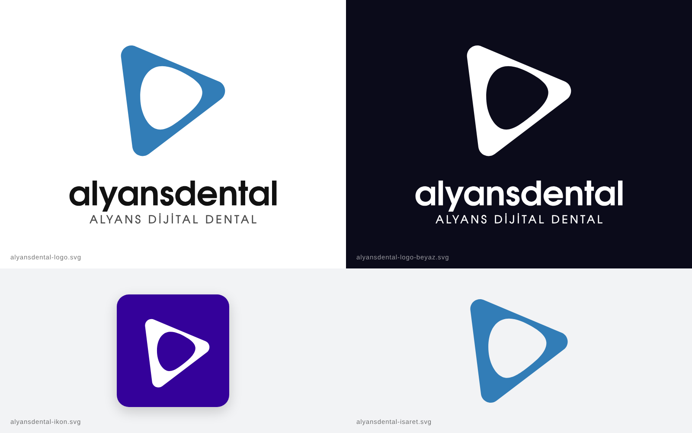

# Alyans Dental — logo (SVG) + sinematik intro

## Logo dosyaları (`svg/`)

| Dosya | Kullanım |
| --- | --- |
| `alyansdental-logo.svg` | Ana logo: mavi işaret + koyu yazı, şeffaf zemin |
| `alyansdental-logo-beyaz.svg` | Koyu zeminler için tamamen beyaz logo |
| `alyansdental-ikon.svg` | Mor zemin üzerine beyaz işaret (profil fotoğrafı / uygulama ikonu), 1024×1024 |
| `alyansdental-isaret.svg` | Yazısız, sadece mavi işaret |

- **Gölge kapalı:** Eski logodaki gri gölge `alyansdental-logo.svg` içinde `id="golge"` katmanı olarak duruyor ama `display="none"` ile devre dışı. Geri açmak isterseniz bu özniteliği silmeniz yeterli.
- **İşaret geometrisi:** Referans görseldeki işaretten ölçülerek çizildi. Dış hat, köşeleri eşit yuvarlatılmış eşkenar bir üçgen; içteki boşluk 6 noktalı yumuşak bir Bézier eğrisi. Referansla sapma yaklaşık %0,25.
- **Yazılar eğriye çevrildi.** Font kurmanız gerekmiyor. Kullanılan font TeX Gyre Adventor (Avant Garde Gothic muadili, açık lisanslı). Ölçüleri orijinal logodaki yazıyla birebir tutuyor.
- `png/` klasöründe aynı dosyaların PNG kopyaları var (logolar 2400 px genişliğinde, ikon ve işaret 1024 px).

### Renkler

| Renk | HEX |
| --- | --- |
| Marka mavisi | `#327DB7` |
| İkon moru | `#34019A` |
| Logo yazısı | `#111111` |
| Alt yazı | `#4D4D4D` |

## Intro videosu (`video/`)

`alyansdental-intro.mp4`: 1920×1080, 30 fps, 5,5 sn, H.264 + AAC stereo ses.

| Süre | Olay |
| --- | --- |
| 0,0 – 1,2 sn | Karanlık sahne açılır, işaret derinlikten dönerek uçar ve iner (whoosh + darbe sesi) |
| 1,1 – 2,4 sn | "alyansdental" harfleri sırayla döner, alt yazı ortadan açılır |
| 2,2 – 2,8 sn | **"Zım"**: logonun üzerinden ışık süpürülür ve uçta yıldız parlar |
| 3,6 – 4,5 sn | **Vakum**: logo, yazılar ve toz parçacıkları işaretin boşluğuna girdap gibi emilir |
| 4,5 sn | **"Çık"**: pop flaşı ve şok halkası |
| 5,0 – 5,5 sn | Siyah ekran. Asıl içeriğinizi buradan sonra kesmeden ekleyebilirsiniz |

Ses dosyası ayrıca `ses/alyansdental-intro-sfx.wav` olarak da var (48 kHz, yaklaşık −16 LUFS).

## Blender projesi (`blender/`)

`alyansdental-intro.blend` dosyası Blender 5.2 LTS ile açılır (render motoru Cycles). Önemli kontroller:

- **Vakum:** `Vakum` adlı geometry nodes grubundaki `Progress` (emiş) ve `Breath` (öncesindeki nefes) değerleri anahtar karelidir. Emişin hedef noktası `VakumMerkezi` adlı boş nesnedir.
- **Parlama:** `ShineSweep` shader grubundaki `Sweep` (ışık bandının konumu) ve `Intensity` (parlaklık) değerleri.
- **Glow ve yıldız:** Kompozitördeki iki *Glare* düğümü (Bloom + Streaks).
- Render çıktısı `//render/` klasörüne yazılır. Varsayılan 64 örnek; daha hızlı bir önizleme için düşürebilirsiniz.

## Kaynak (`kaynak/`)

- `scene.py`: Sahnenin tamamını kod ile kurar ve render eder (`pip install bpy==5.2.*`).
- `sfx.py`: Ses efektlerinin hepsini sentezler. Hiçbir hazır ses örneği kullanılmadı, telifsizdir.
- `logo_geo.json`: Logonun vektör geometrisi (Blender sahnesi bunu okur).
